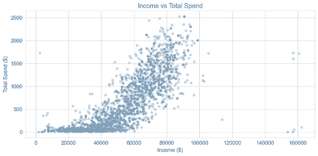
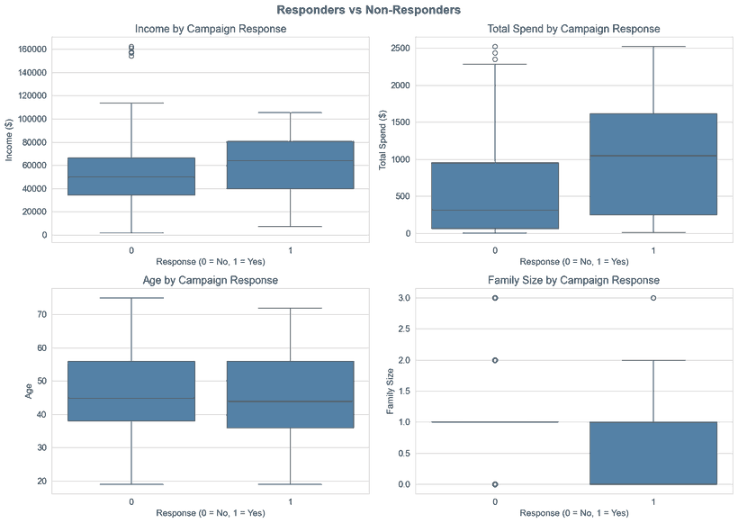

# Marketing Campaign Effectiveness & Customer Segmentation Analysis

An end-to-end customer analytics project in Python. It answers one business question: **how can the company improve its marketing strategy using customer data?** The analysis cleans a customer dataset, engineers new features, profiles who the high-value customers are, and evaluates how past campaigns performed.

**Tools:** Python, Pandas, NumPy, Matplotlib, Seaborn

## Contents

- [Project overview](#project-overview)
- [Dataset and cleaning](#dataset-and-cleaning)
- [Key findings](#key-findings)
- [Recommendations](#recommendations)
- [Limitations](#limitations)
- [Repository structure](#repository-structure)
- [Run the notebook](#run-the-notebook)

## Project overview

The analysis is organised around four objectives, followed by recommendations:

1. **Understand the customers:** age, income, education and marital status.
2. **Identify high-value customers:** how income, age, education and children relate to total spend.
3. **Analyse purchasing behaviour:** which products earn the most revenue and which channels customers prefer.
4. **Evaluate campaign performance:** acceptance rates across six campaigns and the profile of customers who responded to the last one.

The full write-up is in [`case_study/Marketing_Campaign_Case_Study.pdf`](case_study/Marketing_Campaign_Case_Study.pdf), and the code and commentary are in the [notebook](notebook/Marketing_campaign_analysis.ipynb).

## Dataset and cleaning

The raw file has **2,240 customer records and 29 columns** covering demographics, spending by product, purchases by channel, and responses to six campaigns. Cleaning removed 26 rows and 2 columns, leaving **2,214 customers**:

| Issue found | Action |
| --- | --- |
| 24 missing values in `Income` | Rows removed |
| A customer born in 1893 (data entry error) | Row removed |
| A customer with an income of 666,666 (extreme outlier) | Row removed |
| `Z_CostContact` and `Z_Revenue` hold the same value for every customer | Columns dropped |

Seven features were then engineered, including `Age`, `TotalSpend`, `TotalPurchases`, `FamilySize`, `AcceptedAnyCampaign`, `Customer_Days` (tenure) and `HasChildren`, and marital status was simplified into Single and Partner.

## Key findings

### 1. Income has the strongest relationship with spending

Income and total spend have a strong positive correlation (**r = 0.79**). Age is only weakly related to spend (**r = 0.12**), so high spenders appear at every age.



### 2. Customers without children spend about three times more

Customers without children at home spend **$1,104** on average, against **$408** for customers with children. Average spend also rises with education level, from $81 for basic education to $674 for PhD holders.


### 3. Wine and meat drive revenue

Wine averages **$305** per customer and meat **$167**. Together they account for about **78% of product revenue**; the other four categories each average under $45.


### 4. Customers prefer stores, then the web

Average purchases per customer are **5.81 in store**, **4.09 on the web**, **2.67 by catalog** and **2.32 with deals**.


### 5. The last campaign performed best

The last campaign reached a **15.05%** acceptance rate. Campaign 2 was the weakest at **1.36%**, and Campaigns 3 to 5 each landed around 7%.


### 6. Responders look different from non-responders

Customers who accepted the last campaign had higher incomes, higher total spend (median about $1,000 against about $300) and smaller families. Age made almost no difference.



## Recommendations

1. **Prioritise high-income customers** (above roughly $70,000) when allocating campaign budget.
2. **Run premium campaigns for customers without children**, and use bundle or value offers for families.
3. **Concentrate promotion on wine and meat**, and bundle the weaker categories with them.
4. **Keep investing in the store and web experience**, and review catalog spend given its low share of purchases.
5. **Study the last campaign** (targeting, timing and creative) before repeating or scaling it.

## Limitations

- The findings are **correlations from a single dataset**. They show which customers spend more, not that income or family status causes spending.
- Campaign acceptance does not prove **incremental sales**. Some accepters might have bought without the campaign, so check the audience and offer before reallocating budget.
- The customer profiles are built from descriptive comparisons. No clustering or predictive model was fitted.
- Spend and income are in dollars as given in the source data.

## Repository structure

```text
.
├── README.md
├── case_study/
│   └── Marketing_Campaign_Case_Study.pdf
├── notebook/
│   └── Marketing_campaign_analysis.ipynb
├── images/
│   └── (charts used in this README)
├── requirements.txt
└── .gitignore
```

## Run the notebook

The notebook reads the source workbook from `data/marketing_campaign.xlsx`. The workbook is not included in this repository, so place your copy at that path first.

```bash
python -m venv .venv
source .venv/bin/activate  # Windows: .venv\Scripts\activate
pip install -r requirements.txt
jupyter notebook notebook/Marketing_campaign_analysis.ipynb
```

## Author

**Tomiwa Richard Adesugba**: [LinkedIn](https://www.linkedin.com/in/tomiwa-adesugba-57b916420) | [GitHub](https://github.com/Tomiwa-richard) | [Portfolio](https://tomiwa-portfolio.work-wall.workers.dev/)
