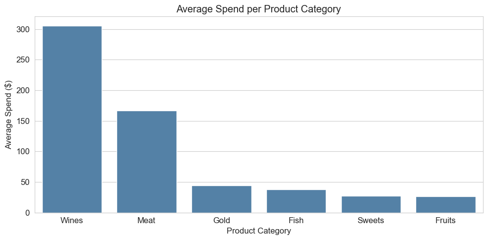
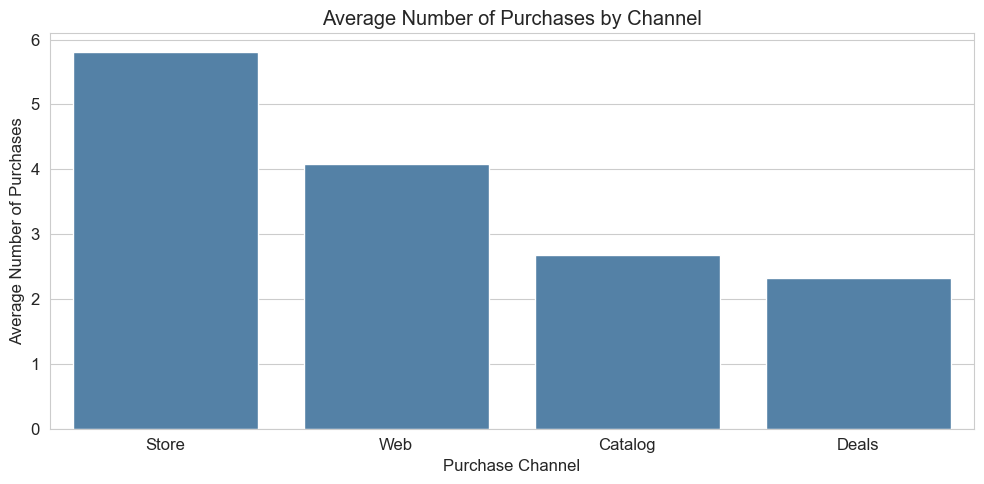
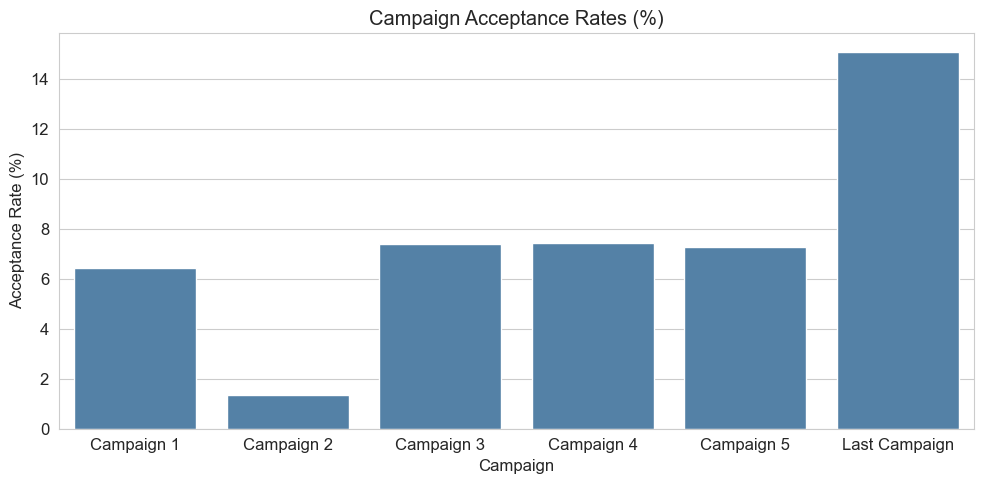

# Marketing Campaign Analysis

A customer analytics case study exploring purchasing behavior, customer value, product and channel preferences, and marketing campaign response. The analysis is based on the supplied marketing campaign case study and notebook by Tomiwa Richard.

## Project structure

```text
.
├── README.md
├── case_study/
│   └── Marketing_Campaign_Case_Study.pdf
├── analysis.py
├── images/
│   ├── campaign_acceptance.png
│   ├── product_spend.png
│   └── purchase_channels.png
├── requirements.txt
└── .gitignore
```

## Headline findings

- **2,212 customers** in the case study's final analysis sample.
- **Income and customer spend** have a strong positive correlation (**0.79**).
- **Wine** leads average spend per customer (**$305**), followed by meat (**$167**).
- Customers make the most purchases in **stores (5.81)**, then on the web (**4.09**), on average.
- The **last campaign** has the highest reported acceptance rate (**15.05%**); Campaign 2 is lowest (**1.36%**).
- The case study reports average spend of **$1,104** for customers without children at home versus **$408** for customers with children.

## Charts

The figures below visualize the reported case-study values. Running `analysis.py` with the source workbook regenerates these charts from the cleaned customer records.

### Average spend by product category



### Average purchases by channel



### Campaign acceptance rates



## Run the analysis

The customer workbook was not included with the supplied notebook and case study, so it is not committed to this repository. Add the original `marketing_campaign.xlsx` workbook to a local `data/` directory, or provide its location with `--data`.

```bash
python -m venv .venv
source .venv/bin/activate  # Windows: .venv\Scripts\activate
pip install -r requirements.txt
python analysis.py
```

Use a different input/output location if needed:

```bash
python analysis.py --data /path/to/marketing_campaign.xlsx --output-dir images
```

The script prints a compact summary and saves three PNG charts in `images/`.
